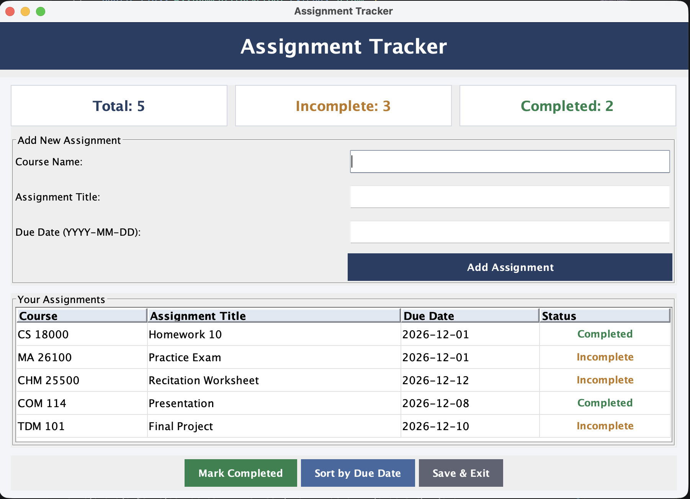

# Assignment Tracker

## Project Overview

Assignment Tracker is a Java desktop application designed to help college students organize assignments, manage deadlines, and track their progress.

Students often have assignments across multiple courses, making it difficult to keep track of everything. This application provides a simple graphical interface where students can manage their coursework in one place.

## Features

### MVP Features
- [x] Add assignments with course names, titles, and due dates
- [x] View all assignments
- [x] Mark assignments as completed
- [x] Save assignments to a CSV file
- [x] Load saved assignments automatically

### Additional Features
- [x] Sort assignments by due date
- [x] Java Swing graphical user interface
- [x] Interactive assignment table
- [x] Automatic assignment counters
- [x] Color-coded completion statuses
- [x] Input validation and error handling

## Technologies Used

- Java
- Java Swing
- ArrayList
- LocalDate
- Comparator
- BufferedReader and PrintWriter
- CSV file storage
- Git and GitHub
- Visual Studio Code

## How to Run

Make sure Java is installed on your computer.

### Clone the repository

    git clone https://github.com/ShreyaM2008/Assignment-Tracker.git
    cd Assignment-Tracker

### Compile the application

    javac src/*.java

### Run the GUI version

    java -cp src AssignmentTrackerGUI

### Run the original command-line version

    java -cp src Main

## How to Use

1. Enter the course name, assignment title, and due date.
2. Click Add Assignment.
3. View assignments in the table.
4. Select an assignment and click Mark Completed.
5. Click Sort by Due Date to organize deadlines.
6. Click Save & Exit to save your assignments.

Previously saved assignments are automatically loaded when the application opens.

## Application Screenshot

## Project Structure

- src/Assignment.java - Assignment object and its properties
- src/Main.java - Original command-line application
- src/AssignmentTrackerGUI.java - Graphical user interface
- docs/ - Project planning materials and documentation
- tests/ - Testing directory
- assignments.csv - Automatically generated local data file

## Development Process

The project was initially developed as a command-line application. Each core feature was implemented, tested, and committed separately.

Sorting by due date was added as a Schedule feature. The graphical user interface was then developed on a separate feature branch and merged into the main branch after testing.

## Future Improvements

- [ ] Add assignment priority levels
- [ ] Display upcoming deadline reminders
- [ ] Allow users to edit or delete assignments
- [ ] Add filtering by course
- [ ] Add a calendar view

## Project Documentation

The project planning materials include an Eisenhower Matrix and a system flowchart.

## Video Walkthrough

Video link: To be added

