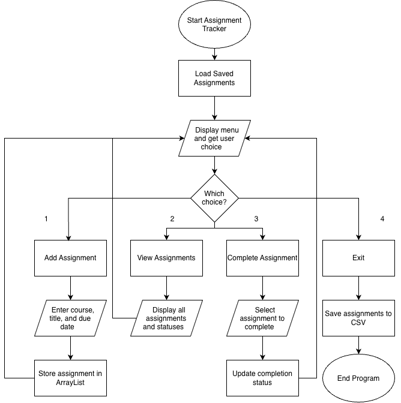

# Assignment Tracker

## Project Overview

Assignment Tracker is a Java desktop application designed to help college students organize assignments, manage deadlines, and track their progress.

Students often have assignments across multiple courses, making it difficult to keep track of everything. This application provides a simple graphical interface where students can manage their coursework in one place.

## Project Goal

The goal of this project is to create a reliable and user-friendly application that helps students stay organized, prioritize upcoming deadlines, and monitor their academic progress.

## Features and Roadmap

### MVP Features

- [x] Add assignments with course names, titles, and due dates
- [x] View all assignments
- [x] Mark assignments as completed
- [x] Save assignments to a CSV file
- [x] Load saved assignments automatically

### Schedule Feature

- [x] Sort assignments by due date

The sorting feature allows users to organize assignments from the earliest to the latest deadline, helping them prioritize upcoming coursework.

### Additional Features

- [x] Java Swing graphical user interface
- [x] Interactive assignment table
- [x] Automatic assignment counters
- [x] Color-coded completion statuses
- [x] Input validation and error handling

## Technologies Used

| Technology | Purpose |
|---|---|
| Java | Main programming language |
| Java Swing | Graphical user interface |
| ArrayList | Assignment storage during execution |
| LocalDate | Date representation and validation |
| Comparator | Sorting assignments by due date |
| BufferedReader | Reading saved assignments |
| PrintWriter | Saving assignments |
| CSV | Persistent local data storage |
| Git and GitHub | Version control |
| Visual Studio Code | Development environment |

## How to Run

### Prerequisites

- Java Development Kit (JDK 8 or later)
- Git
- A terminal or code editor

### Clone the Repository

```bash
git clone https://github.com/ShreyaM2008/Assignment-Tracker.git
cd Assignment-Tracker
```

### Compile the Application

```bash
javac src/*.java
```

### Run the GUI Version

```bash
java -cp src AssignmentTrackerGUI
```

### Run the Original Command-Line Version

```bash
java -cp src Main
```

## How to Use

1. Enter the course name, assignment title, and due date.
2. Click **Add Assignment**.
3. View assignments in the table.
4. Select an assignment and click **Mark Completed**.
5. Click **Sort by Due Date** to organize deadlines.
6. Click **Save & Exit** to save assignments and close the application.

Previously saved assignments are automatically loaded when the application opens.

## Example Input and Output

### Example Input

- Course Name: CS 18000
- Assignment Title: Final Project
- Due Date: 2026-12-01

### Expected Output

After clicking Add Assignment, the following entry appears in the assignment table:

| Course | Assignment Title | Due Date | Status |
|---|---|---|---|
| CS 18000 | Final Project | 2026-12-01 | Incomplete |

After selecting the assignment and clicking Mark Completed:

| Course | Assignment Title | Due Date | Status |
|---|---|---|---|
| CS 18000 | Final Project | 2026-12-01 | Completed |

The assignment counters also update automatically.

## Application Screenshot


## System Diagram

The system flowchart illustrates the application's workflow, including loading saved assignments, processing user actions, and saving data before exiting.



## Project Structure

```text
Assignment-Tracker/
├── src/
│   ├── Assignment.java
│   ├── Main.java
│   └── AssignmentTrackerGUI.java
├── docs/
├── tests/
├── .gitignore
└── README.md
```

- `Assignment.java`: Represents an individual assignment and its properties.
- `Main.java`: Contains the original command-line application.
- `AssignmentTrackerGUI.java`: Contains the graphical user interface and application logic.
- `docs/`: Contains project planning materials and documentation.
- `tests/`: Directory for application testing documentation.
- `assignments.csv`: Automatically generated local data file.
- `.gitignore`: Prevents generated files and local data from being committed.

## Development Process

The project was initially developed as a command-line application. Each core feature was implemented and committed separately to maintain a clear development history.

Sorting by due date was added as a Schedule feature to help users prioritize deadlines.

The graphical user interface was developed on a separate feature branch and merged into the main branch.

JavaDoc and inline comments were added throughout the source code to improve readability and maintainability.

## Testing

The following manual tests can be performed to verify application functionality:

| Test | Expected Result |
|---|---|
| Add a valid assignment | Assignment appears in the table |
| Leave an input field empty | Error message appears |
| Enter an invalid date | Error message appears |
| Enter a comma in a GUI input field | Error message appears |
| Mark an assignment as completed | Status and counters update |
| Complete without selecting an assignment | Error message appears |
| Complete an already completed assignment | Warning message appears |
| Sort assignments | Assignments appear in chronological order |
| Click Save & Exit | Assignments are saved and the application closes |
| Restart the application | Saved assignments are restored |
| Start without a CSV file | Application opens with an empty list |

## Known Limitations

- Due dates must follow the YYYY-MM-DD format.
- Course names and assignment titles should not contain commas because the application uses simple CSV storage.
- Assignments are stored locally and do not synchronize across devices.
- Assignments are saved when the application closes normally.
- Existing assignments cannot currently be edited or deleted.
- The GUI and command-line versions should not be run simultaneously because they share the same CSV file.

## Future Improvements

- [ ] Add assignment priority levels
- [ ] Display upcoming deadline reminders
- [ ] Allow users to edit or delete assignments
- [ ] Add filtering by course
- [ ] Add a calendar view

## Project Documentation

The `docs/` directory contains the project planning materials, including:

- Eisenhower Matrix
- System flowchart
- Project planning documentation
- Application screenshot

## Video Walkthrough

Video link: To be added
